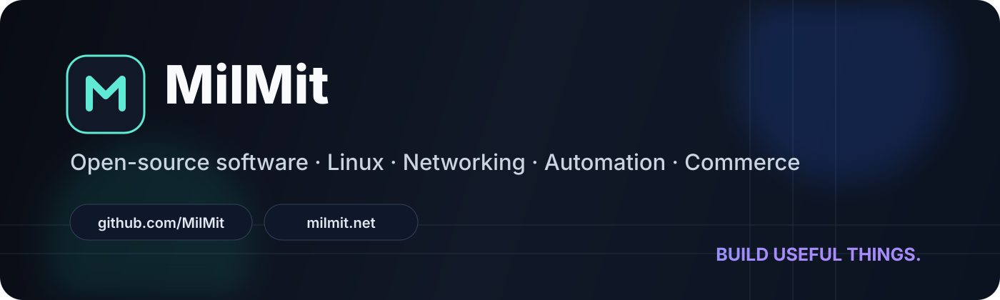

 

<h1>MilMit — Official GitHub Organization</h1>

Open-source software for Linux, networking, automation, Android, WordPress and WooCommerce.

**English** · [فارسی](#فارسی)

---

## Who we are

**MilMit** is an independent software and digital-product organization founded by [Milad Dadgar](https://github.com/miladdadgar). This is the [official MilMit GitHub organization](https://github.com/MilMit), where our public source code, project documentation and releases are maintained.

We build practical tools across **Linux, networking, automation, desktop and mobile apps, WordPress, WooCommerce and API integrations**.

> **Useful software. Clear engineering. No inflated claims.**

## Featured projects

Recent and representative open-source work from the [MilMit GitHub organization](https://github.com/MilMit). Project maturity and release readiness vary; see each repository for the latest status.

<table>
<tr>
<td width="50%" valign="top">
<h3>🌐 <a href="https://github.com/MilMit/modemdeck-linux">ModemDeck</a></h3>

Native Linux cellular-modem management, signal diagnostics and network controls using GTK4 and ModemManager.

</td>
<td width="50%" valign="top">
<h3>💬 <a href="https://github.com/MilMit/chatdesk-linux">ChatDesk Linux</a></h3>

Unofficial ChatGPT desktop client for Linux with isolated profiles, quick capture and desktop workflows.

</td>
</tr>
<tr>
<td width="50%" valign="top">
<h3>🩺 <a href="https://github.com/MilMit/LinuxCare-App">LinuxCare</a></h3>

Rust, GTK4 and Libadwaita-based Linux system maintenance, health insights and diagnostics.

</td>
<td width="50%" valign="top">
<h3>🛒 <a href="https://github.com/MilMit/telenexa-commerce-for-telegram">TeleNexa</a></h3>

WooCommerce commerce integration with a Telegram sales bot and Mini App.

</td>
</tr>
<tr>
<td width="50%" valign="top">
<h3>⚡ <a href="https://github.com/MilMit/mesora-wordpress-live-chat">Mesora</a></h3>

WordPress live chat with multi-channel support and WooCommerce pre-sales context.

</td>
<td width="50%" valign="top">
<h3>🔐 <a href="https://github.com/MilMit/ikev2-linux-for-surfshark">IKEv2 Linux for Surfshark</a></h3>

Unofficial Ubuntu/Linux IKEv2 client using StrongSwan, with connection testing and secure credential storage.

</td>
</tr>
<tr>
<td width="50%" valign="top">
<h3>📲 <a href="https://github.com/MilMit/decimen-android">Decimen Android</a></h3>

Native Android sender and receiver for transferring files and text through animated QR codes, without a network.

</td>
<td width="50%" valign="top">
<h3>🔒 <a href="https://github.com/MilMit/otp-animation-v10">OTP Animation V10</a></h3>

Interactive OTP verification UI with animated lock-and-key transitions, keyboard support and paste handling.

</td>
</tr>
</table>

### More public repositories

- 📡 **[NordVPN WireGuard Extractor](https://github.com/MilMit/nordvpn-wireguard-extractor)** — Bash tooling for extracting NordLynx/WireGuard configurations and creating QR codes.
- 📱 **[AdvanceGram](https://github.com/MilMit/AdvanceGram)** — Unofficial Telegram API-based Android messaging app project.
- 🧪 **[AInstagram](https://github.com/MilMit/AInstagram)** — Small experimental repository with Instagram-related web assets; documentation is not yet available.

See [all public MilMit repositories](https://github.com/orgs/MilMit/repositories).

## Technology map

  

| Area | Focus |
| --- | --- |
| **Linux & Desktop** | Rust, GTK4, Libadwaita, Electron, Ubuntu, GNOME |
| **Mobile** | Android, Flutter, Dart, Java |
| **Networking** | VPN, IKEv2, WireGuard, diagnostics and connectivity |
| **WordPress & Commerce** | WordPress, WooCommerce, PHP, plugins and integrations |
| **Automation** | Telegram, APIs, bots and workflow automation |
| **Product Engineering** | UX, security, packaging, CI/CD and release engineering |

## Explore MilMit on GitHub

Browse [all MilMit public repositories](https://github.com/orgs/MilMit/repositories) for source code, documentation, issues and available releases. The [MilMit organization page](https://github.com/MilMit) is the official GitHub home for these projects.

## Engineering principles

- Build features that solve real problems instead of inflating feature lists.
- Keep security boundaries and privileged operations explicit.
- Prefer reversible and inspectable system operations.
- Verify functionality instead of claiming behavior the software cannot prove.
- Treat documentation, privacy and release quality as part of the product.
- Keep open-source projects understandable enough to inspect and improve.

## Open source

Selected MilMit projects are public so developers can inspect the implementation, reproduce issues, contribute improvements and reuse ideas responsibly.

A useful bug report includes the environment, exact reproduction steps, expected behavior, actual behavior and relevant logs with secrets removed.

## Founder

MilMit was founded by **[Milad Dadgar](https://github.com/miladdadgar)**, a software developer with approximately 13 years of programming experience.

His work spans software engineering, Linux tooling, networking, web platforms and biomedical research.

**Research:** [Molecular Biology Reports — Springer](https://doi.org/10.1007/s11033-026-11566-8) · [PubMed](https://pubmed.ncbi.nlm.nih.gov/41774233/)

## فارسی

**MilMit | میل‌میت** یک مجموعه مستقل توسعه نرم‌افزار و محصولات دیجیتال است که توسط **[میلاد دادگر](https://github.com/miladdadgar)** تأسیس شده است.

تمرکز MilMit روی ساخت ابزارهای کاربردی و قابل اتکا در حوزه‌های **Linux، شبکه و VPN، اتوماسیون، اپلیکیشن‌های دسکتاپ و موبایل، WordPress، WooCommerce و یکپارچه‌سازی API** است.

بخشی از پروژه‌های MilMit به‌صورت متن‌باز منتشر می‌شوند تا توسعه‌دهندگان بتوانند کد را بررسی کنند، مشکلات را گزارش دهند و در توسعه پروژه‌ها مشارکت داشته باشند.

**پروژه‌های شاخص:** [ModemDeck](https://github.com/MilMit/modemdeck-linux)، [LinuxCare](https://github.com/MilMit/LinuxCare-App)، [ChatDesk Linux](https://github.com/MilMit/chatdesk-linux)، [TeleNexa](https://github.com/MilMit/telenexa-commerce-for-telegram)، [Mesora](https://github.com/MilMit/mesora-wordpress-live-chat)، [Decimen Android](https://github.com/MilMit/decimen-android) و [OTP Animation V10](https://github.com/MilMit/otp-animation-v10). فهرست کامل مخازن عمومی در [GitHub سازمان MilMit](https://github.com/orgs/MilMit/repositories) قرار دارد.

## Connect

**Website:** [milmit.net](https://milmit.net) · **GitHub:** [github.com/MilMit](https://github.com/MilMit) · **Founder:** [Milad Dadgar](https://github.com/miladdadgar)

---

### Build useful things. Keep the engineering honest.

MilMit · Software · Open technology · Digital products

